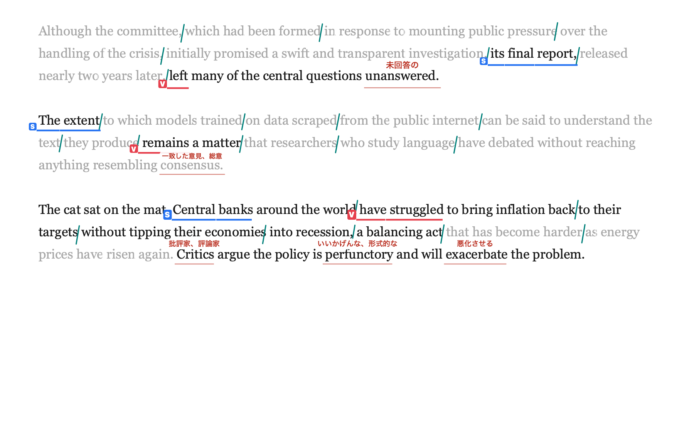

# Hodoku（解く）

英語を、訳に頼らず英文のまま読めるようになるための Mac アプリ。

読んでいてつまずくのは 2 つ。**知らない単語**と、**長い文で何を言っているか見失うこと**。
Hodoku は画面に出ている英文に対してこの 2 つだけをその場で助け、あとは自分で読ませます。
全文訳は出しません。助けは使う人の理解度に合わせて変わり、読めるようになるにつれて引いていきます。

- 画面に出ている英文ならどのアプリでも使えます（ブラウザ、PDF、Slack、画像の中の文字でも）。
- 画面の内容はこの Mac の中だけで処理します。通信するコードは入っていません。
- 自分ひとりで使うためのものです。macOS 26 以降の Apple シリコン Mac 専用で、互換性や配布は考えていません。



## できること

### 知らない単語

知らなそうな語の真上に、短い意味を小さく出します。

| 操作 | 意味 |
| --- | --- |
| 何も出ていない語を **⌥クリック** | この語は知らない → 意味を出す |
| 意味が出ている語を **⌥クリック** | もう知っている → 以後出さない |
| 点線の下線だけの語を **⌥クリック** | 思い出せない → 意味を見る |

助けは次のように引いていきます。

1. 知らない語は、最初は意味を出す（実線の下線 + 意味）。
2. 2 回見せたら、次からは**点線の下線だけ**にする。自分で思い出す番。
3. 意味を見ずに 2 回読めたら卒業。以後は何も出さない。見てしまったら 1. に戻る。

回数に数えるのは 30 分以上あけて出会ったときだけです。

辞書にない語（refactor、Kubernetes などの専門用語や固有名詞）は自動では出ませんが、⌥クリックすれば
端末内の言語モデルがその文での意味を答えます。モデルの答えには **≈** が付きます（辞書の語義より確かさは落ちます）。

どの語を「知らなそう」とみなすかは**語彙レベル**で決まります。易しい語を知らないと伝えれば下がり、
難しい語を知っていると伝えれば上がるので、数回の ⌥クリックで自分に合ってきます。

### 熟語・句

語ごとではなく、言い回しの単位で意味を出します。下線は句全体につながって引かれます。

| 操作 | 意味 |
| --- | --- |
| 熟語の中の語を **⌥クリック** | 熟語として意味を出す（come up with → 〜を思いつく） |
| 同じ語をもう一度 **⌥クリック** | 熟語ではなかった → その語の意味を出す |
| 語から語へ **⌥ドラッグ** | なぞった句（6 語まで）の意味を出す |

- 辞書に載っている熟語（in terms of、by and large、run out of など）は自動で見つけ、単語と同じように
  「意味 → 点線だけ → 卒業」と助けを引いていきます。
- sit on、bring back のような動詞 + 前置詞の 2 語は、文字どおりの用法と見分けられないので、頼まれたときだけ出します。
- 辞書にない言い回しは ⌥ドラッグで選ぶと、端末内の言語モデルが答えます（**≈** 付き）。
  一度選んだ句は覚えていて、次に同じ句に出会ったら頼まなくても句として出します。
- 選べるのは同じ文の中の 6 語までで、文全体は選べません。全文訳はしないためです。

### 長い文

長い文には、意味のかたまりごとに区切り（/）を入れます。訳さず、構造だけを見せます。
文中の語を **⌥⇧クリック** するたびに、その文の助けが一段進みます。

1. 区切りだけ
2. + 主節の主語（S）と動詞（V）
3. + 修飾部（従属節・挿入句）を薄くして、骨組みだけ残す
4. なし

何語以上の文を自動で区切るかも変わっていきます。短めの文で助けを求めればその長さから区切るようになり、
出た助けを消せば基準が上がります。助けを足さずに読めた分だけ、少しずつ基準が上がっていきます。

## 使い方

```bash
scripts/build-app.sh --install
```

```bash
open /Applications/Hodoku.app
```

1. メニューバーに「解」が出ます。
2. 初回は **システム設定 › プライバシーとセキュリティ › 画面収録とシステムオーディオ録音** で Hodoku を許可し、起動し直します。
3. 英文を表示して **⌃⌥R**。カーソルのある画面に注釈が重なります。もう一度 **⌃⌥R** で終了。

読んでいる間も下のアプリはふだんどおり操作できます。スクロールすると注釈はいったん消え、止まると付け直されます。
⌥ を押している間だけ、クリックが Hodoku に届きます。

理解度の記録は `~/Library/Application Support/Hodoku/learner.json` にあります。

## しくみ

| | 使っているもの |
| --- | --- |
| 画面の取り込み | ScreenCaptureKit（自分の注釈は除いて取り込む） |
| 文字認識 | Vision |
| 単語の意味 | macOS 内蔵の「ウィズダム英和辞典」（辞書.app の辞書） |
| 単語の難しさ | 辞書の記述量。よく使う語ほど記述が長い |
| 熟語 | 同じ辞書の成句見出し（"come up with A" の形）を、文中の語の並びから引く |
| 文脈に合う語義選び | 端末内の言語モデル（Apple Intelligence）。候補は辞書の語義だけ |
| 辞書にない語・選んだ句 | 端末内の言語モデル。語句だけを渡し、短い意味だけを受け取る |
| 文の構造 | NaturalLanguage の品詞判定 + 規則 |

辞書データや頻度表は同梱していません。すべて macOS に入っているものを実行時に使います。

## 知っておくこと

- 内蔵辞書を辞書指定で引くために、Dictionary Services の非公開関数を使っています。OS の更新で動かなくなる可能性があります。
- 辞書.app の設定で「ウィズダム英和辞典」が有効になっている必要があります。
- 熟語は表記の並びだけで見つけるので、たまたま同じ並びになった文字どおりの表現を熟語として出すことがあります。
- 端末内モデルの答え（≈ 付き）は、辞書の語義ほど確かではありません。
- 文の構造は規則による推定です。入り組んだ文では主語・動詞を取り違えることがあります。
- 難しさの推定は粗いです（専門用語が易しめに、身近な名詞が難しめに出ることがある）。⌥クリックで直せば、その語については二度と間違えません。
- 署名用の証明書がないとアドホック署名になり、ビルドし直すたびに画面収録の許可を取り直す必要があります。`scripts/make-signing-cert.sh` で自分用の自己署名証明書をログインキーチェーンに作っておくと、以後のビルドはそれで署名され、許可が引き継がれます。

## 開発

```bash
swift build -c release
```

画面収録の許可なしで確かめるためのコマンドがあります。

```bash
.build/release/Hodoku --selftest
```

```bash
.build/release/Hodoku --parse "The extent to which models can be said to understand the text they produce remains a matter of debate."
```

```bash
.build/release/Hodoku --sample /tmp/sample.png && .build/release/Hodoku --image /tmp/sample.png --out /tmp/out.png --level 3
```

## ライセンス

MIT
